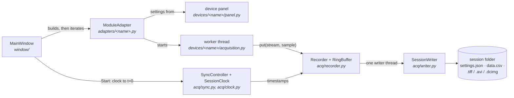

# How acqApp fits together

A one-page map for someone opening the code for the first time. File-by-file
detail is in [STRUCTURE.md](STRUCTURE.md); operating the rig is in
[USER_GUIDE.md](USER_GUIDE.md).

## The flow of one session

1. **Startup** ([main.py](../main.py)): makes or enters the venv, opens the
   voltage camera early (it takes ~8 s), shows the module picker, then builds
   `MainWindow`.
2. **The window** ([window/](../window/)) builds one `ModuleAdapter` per enabled
   instrument and lays out their panels and docks. It never contains
   instrument-specific logic; it only loops over adapters.
3. **Start** resets the shared clock to t = 0, then each adapter starts its
   worker. Every sample is stamped on that one clock, so all streams line up.
4. **Record** opens a session folder. Workers hand samples to the `Recorder`,
   which queues them in a ring buffer; a single writer thread drains it to
   disk, so no acquisition thread ever waits on the disk.
5. **Stop** closes the files and writes final metadata.

## Where things live

| Folder | Job | Imports Qt? |
|---|---|---|
| `acq/` | clock, sync bus, recorder, ring buffer, writers | `sync.py`, `worker.py` |
| `devices/<name>/` | one instrument: driver, worker, settings model, panel | not `settings.py` |
| `adapters/` | plugs each instrument into the window | yes |
| `routines/` | step-by-step experiment protocols | UI files only; the engine is Qt-free |
| `saving/` | where a recording goes, and its file names | `panel.py`, `bpod_dialog.py` |
| `window/` | the main window: services, docks, session/recording | yes |

Inside a device package, `settings.py` is the model (no Qt) and `panel.py` the
UI. Arrows only point one way (window → adapters → devices); the import graph
in STRUCTURE.md is checked by `tests/test_structure.py`.

## A module adapter

Each instrument has one subclass of `ModuleAdapter`
([adapters/base.py](../adapters/base.py)). The window calls these, in order:

| Method | When |
|---|---|
| `build_panel()` | once: its settings widget |
| `view_widget()` | once: its live view, if it has one |
| `build_controller(emulate)` | at startup and whenever Emulate is toggled |
| `build_session(emulate)` | each session: create the worker, don't start it |
| `start()` | after the clock reaches t = 0 |
| `update_display()` | ~30 Hz while running |
| `attach_sink(rec)` / `detach_sink()` | at record start / stop |
| `metadata()` / `final_metadata()` | at record start / just before close |
| `stop()` | session teardown |

An adapter reaches the window only through the `ModuleHost` services
([window/services.py](../window/services.py), documented in
`acq/devices.py`). Adapters never import each other: a routine that moves the
stage asks the window for a `stage_target()`.

## Adding an instrument

1. `devices/<name>/`: the driver, a worker (a `PullWorker`, so a crash is
   reported, not fatal), `settings.py` and `panel.py`.
2. `adapters/<name>.py`: a `ModuleAdapter` subclass. Copy
   `adapters/wheel.py`, the simplest complete one.
3. Register it in three places: `adapters.ADAPTERS`, `config.MODULES`, and an
   accent colour in `style.HEX`.
4. Add the new files to STRUCTURE.md's tree; `tests/test_structure.py` fails
   until you do.

## Customizing a rig

Per-machine settings are JSON files, not code:

- `rigs.json`: one profile per rig, selected by `"rig"` in
  `acqapp_local.json`. A profile can set:
  - `ni_device`: the NI-DAQ device name;
  - `channels`: the DAQ line for each signal (`"port0/line7"`, `"ai2"`);
  - `hardware`: `false` for anything not fitted;
  - `timing`: optional overrides, in seconds, of `move_timeout_s` (stage
    arrival), `trigger_timeout_s` (wait for a TTL edge) and
    `camera_hold_timeout_s` (camera returning after a file roll).
- `modes.json`: named presets (camera preset and exposure, DMD all-on) for
  the General panel's Mode menu; hand-edited, or written by its save button.
- Each device's own settings save automatically from its panel into
  `acqapp_local.json`.
